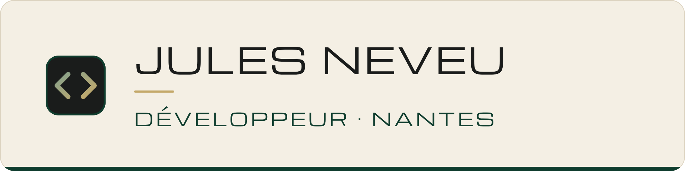

<picture>
  <source media="(prefers-color-scheme: dark)" srcset="assets/banner-dark.png">
  
</picture>

  <a href="https://app-25fa744b-25eb-4ea0-9d7e-88fe870d5552.cleverapps.io">Portfolio</a> ·
  <a href="https://www.linkedin.com/in/jules-neveu-167645258">LinkedIn</a> ·
  <a href="mailto:neveu.jules58@gmail.com">neveu.jules58@gmail.com</a>

Je développe surtout des outils que j'utilise moi-même : une application de bureau pour travailler avec Claude Code, des skills pour agents IA, un assistant vocal qui tourne sur mes machines.

Ce qui m'intéresse, c'est l'architecture. Comment les parties d'un système communiquent, ce qui se passe quand l'une d'elles tombe, et comment le faire tourner dans la durée. Je touche à plusieurs domaines (backend, applications desktop, IA locale, Linux) et j'apprends en construisant.

## Ma façon de travailler

- **L'IA propose, le code décide.** Dans Aether, le SDK de Claude tourne dans un processus isolé et rien de destructeur ne part sans confirmation.
- **Je teste ce que je livre.** Vitest et Playwright sur Aether, tests Go sur le forum et sur Hangman-classic.
- **Je vais jusqu'à la mise en ligne.** Mon portfolio est hébergé sur Clever Cloud, l'application de l'atelier TODO sur Scalingo.
- **J'écris ce qui manque.** Chaque projet documente son installation, et ses limites connues quand il en a.

## Projets personnels

### [Aether](https://github.com/NardenLaSouris/aether) · poste de travail pour Claude Code

Une application de bureau Windows qui pilote Claude Code, installé sur la machine. Plusieurs conversations en parallèle, les limites d'usage toujours visibles, chaque tâche dans sa propre branche Git jusqu'à la pull request, et des mods pour modifier l'interface.

- Le SDK de Claude tourne dans un processus séparé : s'il plante, l'application reste ouverte et il redémarre seul.
- L'interface n'a pas accès à Node.js. Chaque échange avec le processus principal passe par une liste blanche validée avec zod.
- Rien de destructeur sans confirmation : push, suppression d'une branche de travail, commande envoyée par un mod.

`TypeScript` `Electron` `React` `Tailwind` `Zustand` `Claude Agent SDK` `Vitest` `Playwright`

**État :** en développement (v0.2.0), Windows uniquement.

### [portfolio-](https://github.com/NardenLaSouris/portfolio-) · mon portfolio

Mon site, écrit en HTML, CSS et JavaScript sans framework et servi par un petit serveur Node.js sans aucune dépendance. Thème clair et sombre, filtres de projets, et les dépôts GitHub publics chargés automatiquement.

`HTML` `CSS` `JavaScript` `Node.js` `Clever Cloud`

**État :** [en ligne](https://app-25fa744b-25eb-4ea0-9d7e-88fe870d5552.cleverapps.io), mis à jour au fil des projets.

### Et aussi

- **Skills pour agents IA** · j'écris des skills pour des agents comme Claude Code : des instructions et des scripts qu'un agent charge pour mener une tâche précise de la même façon à chaque fois.
- **ORION** · assistant vocal qui tourne entièrement sur mes machines, sans service cloud. Dépôt privé, présenté sur [mon portfolio](https://app-25fa744b-25eb-4ea0-9d7e-88fe870d5552.cleverapps.io/orion.html).

## Projets de formation

Réalisés pendant ma formation en développement, seul ou en équipe.

### [Forum-Project](https://github.com/NardenLaSouris/Forum-Project) · forum web

Un forum inspiré de Reddit, réalisé en équipe : comptes et sessions, publications par catégories, commentaires, likes et dislikes.

- Serveur Go sans framework web, pages rendues côté serveur avec les templates Go.
- Mots de passe hachés avec bcrypt, sessions par cookie, base SQLite.
- Tests Go sur les routes et les likes, Dockerfile pour le lancer.

`Go` `SQLite` `HTML` `CSS` `JavaScript` `Docker`

**État :** terminé.

### [Projet_RPG_TypeScript](https://github.com/NardenLaSouris/Projet_RPG_TypeScript) · jeu de rôle

Un jeu de rôle au tour par tour dans le terminal, à trois. On compose une équipe de trois aventuriers parmi six classes, on traverse cinq salles et on affronte un boss.

- Programmation orientée objet : chaque classe de personnage et chaque monstre hérite d'une base commune et redéfinit ses actions.
- Ordre des tours selon la vitesse, actions propres à chaque classe, inventaire partagé.

`TypeScript` `Deno`

**État :** terminé.

### Autres

- [**Hangman-classic**](https://github.com/NardenLaSouris/Hangman-classic) · pendu en Go organisé en paquets : difficultés, codes de triche, mode deux joueurs.
- [**Projet-red**](https://github.com/NardenLaSouris/Projet-red) · jeu de rôle en Go dans le terminal : classes, marché, forgeron, combats.
- [**GalaxiEat**](https://github.com/NardenLaSouris/GalaxiEat) · base de données SQL d'une chaîne de restaurants, de la modélisation aux requêtes d'analyse.
- [**ATELIER TODO App**](https://github.com/NardenLaSouris/ATELIER-FIL-CONDUCTEUR---TODO-APP) · atelier de déploiement en binôme : serveur Express, connexion PostgreSQL, mise en ligne sur Scalingo.
- [**Piscine Go**](https://github.com/NardenLaSouris/Piscine-go-nantes-2526) · mes exercices d'algorithmique en Go.
- Mes premiers programmes en Python, au lycée : [Puissance 4](https://github.com/NardenLaSouris/connect-4-python), [solveur de Sudoku](https://github.com/NardenLaSouris/Sudoku-Solver-Python), [pendu](https://github.com/NardenLaSouris/Hangman-Python).

## Technologies

Ce que j'utilise dans mes projets.

- **Langages :** Python, Go, TypeScript, JavaScript, SQL, HTML, CSS
- **Frontend :** React, Tailwind CSS, Zustand, interfaces sans framework
- **Backend :** Node.js, Express, serveurs HTTP en Go
- **Desktop :** Electron
- **IA :** Claude Agent SDK, Ollama (modèles locaux)
- **Données :** SQLite, PostgreSQL
- **Infrastructure :** Linux, Docker, Clever Cloud, Scalingo
- **Outils :** Git et GitHub, Vitest, Playwright, ESLint, Deno, Bash

---

Originaire de la Nièvre, basé à Nantes. En dehors du code : le jeu vidéo et le matériel informatique.
